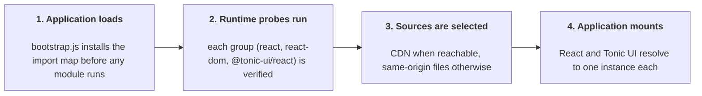
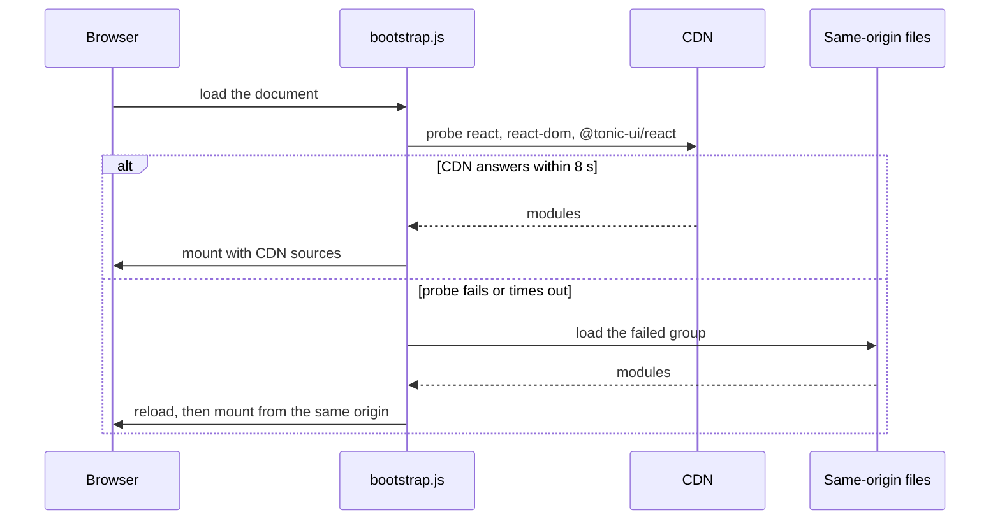

import { Comparisons } from './network-comparison/index';

# CDN loading strategies and local fallback

## Overview

A CDN can serve `@tonic-ui/react` and its dependencies as browser-ready ES modules, so the
application ships without them. Two things break that: every module that calls a hook must
resolve to one React instance, and a CDN request can fail or stall. This page compares the ways
to load the library and shows the fallback that keeps the application mounting when a CDN does
not answer.

**Scope.** These configurations need the package on a public registry. A package published only
to an internal registry (Tonic One and its add-ons) has no esm.sh or jsDelivr entry —
`https://esm.sh/@tonic-one/react` and `https://cdn.jsdelivr.net/npm/@tonic-one/react/+esm` both
return 404. There, only the React family can come from a CDN; the library itself must be served
from your own origin.

Choose the integration approach that best fits your needs:

- **Minimal setup and fewer network requests** → [`Use esm.sh with ?standalone`](#use-esmsh-with-standalone).
- **Single CDN with inspectable, per-package bundles** → [`Use jsDelivr with +esm`](#use-jsdelivr-with-esm).
- **Standalone build with dependencies from esm.sh** → [`Load dist/standalone through raw.esm.sh`](#load-diststandalone-through-rawesmsh).
- **Standalone build and dependencies from a single CDN** → [`Load dist/standalone through jsDelivr`](#load-diststandalone-through-jsdelivr).
- **Host React and Tonic UI on your own CDN** → [`Use self-hosted CDN for React and dist/standalone`](#use-self-hosted-cdn-for-react-and-diststandalone).
- **No CDN required** → [`Use your application's bundler`](#use-your-applications-bundler).

## CDN loading strategies

What each configuration costs, measured on the same page. Details follow per configuration.

<Comparisons />

> **How these numbers were measured?**
>
> Three cold-cache Chromium runs per configuration; the median is shown. App ready is the time
> from navigation start until the mounted UI appears. Reproduce it with
> [`measure-cdn-strategies.mjs`](https://github.com/trendmicro-frontend/tonic-ui/blob/main/packages/react-docs/scripts/measure-cdn-strategies.mjs)
> in `packages/react-docs/scripts`.

## Configurations

Every configuration is an import map: its `@tonic-ui/react` key is the library entry, the other
keys supply the peers, and the map shown is the one that was measured. The smallest application
that uses it:

```jsx
// app.jsx — your module; the import map resolves these specifiers
import { createRoot } from 'react-dom/client';
import { Box, TonicProvider } from '@tonic-ui/react';

createRoot(document.getElementById('root')).render(
  <TonicProvider colorMode={{ defaultValue: 'light' }}>
    <Box>Hello</Box>
  </TonicProvider>
);
```

A CDN configuration only works if your build step leaves these specifiers external; otherwise
the build inlines them and the map is never consulted. In Vite:

```js
// vite.config.js
export default {
  build: {
    rollupOptions: {
      external: [
        '@tonic-ui/react',
        'react',
        'react/jsx-runtime',
        'react-dom',
        'react-dom/client',
        // Tonic UI's styling imports @emotion/react, its jsx runtime, styled/base,
        // and is-prop-valid; they must stay bare so the map supplies one copy.
        /^@emotion\//,
      ],
    },
  },
};
```

### Use esm.sh with `?standalone`

esm.sh merges the package and its dependencies into one file at request time, then the map
supplies the peers.

```html
<script type="importmap">
{
  "imports": {
    "@tonic-ui/react": "https://esm.sh/@tonic-ui/react@3.0.0-alpha.3?standalone&external=react,react-dom",
    "react": "https://esm.sh/react@19.2.7",
    "react/jsx-runtime": "https://esm.sh/react@19.2.7/jsx-runtime",
    "react-dom": "https://esm.sh/react-dom@19.2.7?external=react",
    "react-dom/client": "https://esm.sh/react-dom@19.2.7/client?external=react"
  }
}
</script>
```

**Measured:** 46 requests · 286.9 KiB wire · 748.2 KiB parsed · largest file 506.7 KiB (68%) · one React instance.

**Import map:** the `@tonic-ui/react` key is the entry; four React-family keys follow. esm.sh rewrites the bundle's
Emotion imports to its own URLs, so the map needs no Emotion keys — Emotion still arrives as
separate requests.

**Pick it** for the fewest requests and nothing to deploy. **Watch out:** the file is built by
esm.sh, not by Tonic UI — it is not `dist/standalone/index.min.js` — and its bytes change when
esm.sh's resolver does. Without
`external=react,react-dom` it pins its own React: 50 requests, two instances.

### Use jsDelivr with `+esm`

jsDelivr bundles each package into one file and pins every dependency to an absolute URL; the
alias map collapses those URLs onto the pinned peers.

```html
<script type="importmap">
{
  "imports": {
    "@tonic-ui/react": "https://cdn.jsdelivr.net/npm/@tonic-ui/react@3.0.0-alpha.3/+esm",
    "react": "https://cdn.jsdelivr.net/npm/react@19.2.7/+esm",
    "react/jsx-runtime": "https://cdn.jsdelivr.net/npm/react@19.2.7/jsx-runtime/+esm",
    "react-dom": "https://cdn.jsdelivr.net/npm/react-dom@19.2.7/+esm",
    "react-dom/client": "https://cdn.jsdelivr.net/npm/react-dom@19.2.7/client/+esm",
    "https://cdn.jsdelivr.net/npm/react@19.3.1/+esm": "https://cdn.jsdelivr.net/npm/react@19.2.7/+esm"
  }
}
</script>
```

**Measured:** 54 requests · 327.8 KiB wire · 1,060.4 KiB parsed · largest file 269.7 KiB (25%) · one React instance.

**Import map:** the entry key, four peer keys, and 17 aliases — 22 entries for this release. The fifth line is one of
them; the rest pin the other React and `@babel/runtime` versions the graph emits.

**Pick it** to keep every package visible in the Network tab. **Watch out:** the alias list
follows the URLs jsDelivr generates, so regenerate it when peer ranges move. Without a map the
page loads seven React versions and fetches 17 modules twice.

### Load `dist/standalone` through `raw.esm.sh`

The file Tonic UI's Rollup build published, served by a CDN. Only the React and Emotion families
stay external.

```html
<script type="importmap">
{
  "imports": {
    "@tonic-ui/react": "https://raw.esm.sh/@tonic-ui/react@3.0.0-alpha.3/dist/standalone/index.min.js",
    "react": "https://esm.sh/react@19.2.7",
    "react/jsx-runtime": "https://esm.sh/react@19.2.7/jsx-runtime",
    "react-dom": "https://esm.sh/react-dom@19.2.7?external=react",
    "react-dom/client": "https://esm.sh/react-dom@19.2.7/client?external=react",
    "@emotion/react": "https://esm.sh/@emotion/react@11.14.0?external=react",
    "@emotion/react/jsx-runtime": "https://esm.sh/@emotion/react@11.14.0/jsx-runtime?external=react",
    "@emotion/styled/base": "https://esm.sh/@emotion/styled@11.14.1/base?external=react",
    "@emotion/is-prop-valid": "https://esm.sh/@emotion/is-prop-valid@1.2.2"
  }
}
</script>
```

**Measured:** 49 requests · 279.7 KiB wire · 723.4 KiB parsed · largest file 477.4 KiB (66%) · one React instance.

**Import map:** the `@tonic-ui/react` key is the artifact; eight peer keys follow — its six bare specifiers and
`react/jsx-runtime` with `react-dom/client`. The file is fixed: 488,858 bytes, SHA-256
`1aea08cb…`, identical wherever it is served.

**Pick it** to get the artifact without deploying it. **Watch out:** the plain `esm.sh` host
answers this path with a 478-byte wrapper; only `raw.esm.sh` serves the file.

### Load `dist/standalone` through jsDelivr

The same artifact, with every peer also on jsDelivr.

```html
<script type="importmap">
{
  "imports": {
    "@tonic-ui/react": "https://cdn.jsdelivr.net/npm/@tonic-ui/react@3.0.0-alpha.3/dist/standalone/index.min.js",
    "react": "https://cdn.jsdelivr.net/npm/react@19.2.7/+esm",
    "react/jsx-runtime": "https://cdn.jsdelivr.net/npm/react@19.2.7/jsx-runtime/+esm",
    "react-dom": "https://cdn.jsdelivr.net/npm/react-dom@19.2.7/+esm",
    "react-dom/client": "https://cdn.jsdelivr.net/npm/react-dom@19.2.7/client/+esm",
    "@emotion/react": "https://cdn.jsdelivr.net/npm/@emotion/react@11.14.0/+esm",
    "@emotion/react/jsx-runtime": "https://cdn.jsdelivr.net/npm/@emotion/react@11.14.0/jsx-runtime/+esm",
    "@emotion/styled/base": "https://cdn.jsdelivr.net/npm/@emotion/styled@11.14.1/base/+esm",
    "@emotion/is-prop-valid": "https://cdn.jsdelivr.net/npm/@emotion/is-prop-valid@1.2.2/+esm"
  }
}
</script>
```

**Measured:** 25 requests · 209.7 KiB wire · 718.1 KiB parsed · largest file 477.4 KiB (66%) · one React instance.

**Import map:** the artifact as the entry key, the same eight peer keys on jsDelivr, and 20 aliases that pin
the peer URLs the graph emits — 29 entries for this release.

**Pick it** when one origin should serve everything and you do not want to host the file.
**Watch out:** the peer URLs are version-pinned; regenerate the map when React or Emotion moves.

### Use self-hosted CDN for React and `dist/standalone`

Your own CDN serves the Tonic UI artifact and complete standalone bundles for React, React DOM,
and Emotion, so no third-party origin is involved. The map points every bare specifier at those
files.

```html
<script type="importmap">
{
  "imports": {
    "@tonic-ui/react": "https://your-origin.example/standalone/index.min.js",
    "react": "https://your-origin.example/react.js",
    "react/jsx-runtime": "https://your-origin.example/react.js",
    "react-dom": "https://your-origin.example/react-dom.js",
    "react-dom/client": "https://your-origin.example/react.js",
    "@emotion/react": "https://your-origin.example/emotion-react.js",
    "@emotion/react/jsx-runtime": "https://your-origin.example/emotion-react.js",
    "@emotion/styled/base": "https://your-origin.example/emotion-styled-base.js",
    "@emotion/is-prop-valid": "https://your-origin.example/emotion-is-prop-valid.js"
  }
}
</script>
```

**Measured:** 7 requests · 172.3 KiB wire · 705.1 KiB parsed · largest file 477.4 KiB (68%) · one React instance.

**Import map:** the artifact as the entry, React and React DOM as two bundles, and four Emotion
specifiers served by two Emotion bundles (the React family is shared, so `react/jsx-runtime` and
`react-dom/client` reuse `react.js`).

**Pick it** when the library should live under your own cache, allow list, and CSP.
**Watch out:** you build and deploy five files yourself — the artifact, `react.js`,
`react-dom.js`, and the Emotion bundles. A missing file, a wrong MIME type, or a blocked CSP
entry stops the mount, and nothing retries.

### Use your application's bundler

Bundle React, React DOM, Tonic UI, and their dependencies with your application. The imports
resolve at build time, so no import map is involved and no separate CDN runtime is required.

```html
<script type="module" src="./assets/app-bundled-B69I4X1_.js"></script>
```

**Measured:** 1 request · 83.8 KiB wire · 345.8 KiB parsed · largest file 345.8 KiB (100%) · one React instance.

| Bundled dependency | Source |
| :--- | :--- |
| React, React DOM | `node_modules`, one copy each |
| Tonic UI | `@tonic-ui/react`, tree-shaken |
| Emotion | `@emotion/*`, inside the same chunk |

**Pick it** for one origin, no import map, and no peer resolution to police. **Watch out:** you
give up the CDN cache and must rebuild to change the library. The build is
[`vite.app.config.mjs`](https://github.com/trendmicro-frontend/tonic-ui/blob/main/examples/cdn-with-local-fallback/vite.app.config.mjs);
the entry is [`entries/app-bundled.jsx`](https://github.com/trendmicro-frontend/tonic-ui/blob/main/examples/cdn-with-local-fallback/entries/app-bundled.jsx).

## CDN with local fallback

### How the fallback works

Fallback is an application feature, not something esm.sh or jsDelivr provides. You need it when
the CDN cannot deliver the module graph: the network blocks it, an on-demand build is
unavailable, or a request exceeds the group's eight-second budget.





The runtime resolves `react`, `react-dom`, and `@tonic-ui/react` as separate groups. A failed
probe or an expired budget reloads the document with that group forced to same-origin files. A
local, CSS, or mount failure is terminal: it does not retry a CDN.

### Run the fallback inspector

```bash
cd examples/cdn-with-local-fallback
npm run dev             # reference application
npm run dev:inspector   # interactive runtime inspector
```

The inspector covers six scenarios: CDN-first, React family fails, `@tonic-ui/react` CDN fails,
all CDN families fail, no `@tonic-ui/react` CDN configuration, and all-local. The runtime status
table and load log show which source each group resolved to.

{render('./fallback-inspector')}

Append `?__local=react,react-dom,@tonic-ui/react` to the reference application's URL to force
same-origin files. Remove `__local` and `__failed` to retry CDN-first loading.

### Add the local fallback to your app

Use the [complete reference project](https://github.com/trendmicro-frontend/tonic-ui/tree/main/examples/cdn-with-local-fallback) instead of assembling a partial import map by hand. Its application
is [src/app.jsx](https://github.com/trendmicro-frontend/tonic-ui/blob/main/examples/cdn-with-local-fallback/src/app.jsx),
built by Vite; the bootstrap calls its `mount(element, runtime)` export after the probes succeed.

| Step | File or action | Why it matters |
| :--- | :--- | :--- |
| 1. Install | [package.json](https://github.com/trendmicro-frontend/tonic-ui/blob/main/examples/cdn-with-local-fallback/package.json) | Pins React, React DOM, and the Emotion packages that Tonic UI needs |
| 2. Entries | [entries.mjs](https://github.com/trendmicro-frontend/tonic-ui/blob/main/examples/cdn-with-local-fallback/entries.mjs), `entries/` | Defines the local runtime bundles and what each one leaves external |
| 3. Build | [vite.config.mjs](https://github.com/trendmicro-frontend/tonic-ui/blob/main/examples/cdn-with-local-fallback/vite.config.mjs) | Builds the application and the local vendor runtimes separately |
| 4. Bootstrap | [public/bootstrap.js](https://github.com/trendmicro-frontend/tonic-ui/blob/main/examples/cdn-with-local-fallback/public/bootstrap.js) | Installs the import map before any application module runs |
| 5. Manifest | [scripts/build.mjs](https://github.com/trendmicro-frontend/tonic-ui/blob/main/examples/cdn-with-local-fallback/scripts/build.mjs), [scripts/manifest.mjs](https://github.com/trendmicro-frontend/tonic-ui/blob/main/examples/cdn-with-local-fallback/scripts/manifest.mjs) | Generates the runtime groups, CDN candidates, probes, and Emotion mappings |
| 6. Deploy | `npm run build` → `npm run preview` | Serve all of `dist/`, so fallback files stay reachable |

`scripts/emotion-redirects.mjs` adds the Emotion aliases the CDN build needs; removing them can
leave `Box p="4x"` at `padding: 0px` with no error.

### Integrate the local fallback with AI

Paste this into your AI coding assistant. It clones the reference project, states the runtime
requirements, and asks for PASS/FAIL evidence per acceptance criterion, so the result is
verifiable rather than plausible.

````text
Integrate CDN-first loading with a same-origin fallback into this React application.

## Reference implementation

Clone the official Tonic UI repository:

```bash
git clone --depth 1 https://github.com/trendmicro-frontend/tonic-ui.git
```

Read `examples/cdn-with-local-fallback/README.md` and inspect the following files before making changes:

- `public/bootstrap.js` — import map, runtime probes, fallback reloads, and mounting.
- `scripts/build.mjs` — runtime builds and manifest generation.
- `scripts/manifest.mjs` — runtime groups, package versions, and CDN candidates.
- `scripts/emotion-redirects.mjs` — shared Emotion module mappings.
- `entries.mjs` and `entries/` — local runtime entries and external dependencies.
- `vite.config.mjs` — application and runtime build configuration.
- `src/app.jsx` — application mounting contract.

Record the reference commit SHA.

Use the actual source code as the reference. Do not recreate the architecture from assumptions or invent missing APIs.

## Integration

1. Inspect the existing application's dependencies, entry points, routing, and build configuration.
2. Identify the required changes before modifying files.
3. Reuse the reference bootstrap, runtime entries, manifest generation, and Emotion mappings.
4. Adapt the application's entry point to support `mount(element, runtime)`.
5. Adapt the build configuration and generate the runtime assets.
6. Build, test, and verify the result.

Preserve existing application behavior, routing, Providers, and configuration.

Use installed package versions. Avoid unnecessary dependency upgrades or build-system replacements.

The reference uses Vite. If this application uses another bundler, identify compatibility differences and adapt only what is necessary. Do not assume Vite-specific behavior works unchanged.

Do not replace the application with the reference demo.

## Runtime requirements

1. Install one import map before any application module executes.
2. Manage `react`, `react-dom`, and `@tonic-ui/react` as independently selectable runtime groups.
3. Prefer CDN sources and probe each group's required imports.
4. On CDN probe failure or an 8-second timeout, reload with only the failed group forced to same-origin files.
5. Preserve fallback state through `__local` and `__failed`. Never repeatedly retry a failed group.
6. Treat local runtime, manifest, CSS, application loading, and mounting failures as terminal errors.
7. Preserve a single React instance across the application and its dependencies, including mixed CDN/local configurations.
8. Preserve consistent Emotion module identity and component styling through the generated mappings.
9. Follow the reference's CDN source-selection behavior, including published standalone artifacts and esm.sh fallback.
10. Generate the manifest from actual installed versions and build outputs. Do not hardcode hashed filenames.
11. Include every referenced asset in the production deployment.

Native import maps cannot be rebound after modules have loaded. CDN recovery must use a fresh document.

If the reference implementation does not satisfy a requirement, identify the exact cause and apply only a justified, minimal correction. Do not blindly copy a known issue or introduce speculative workarounds.

## Verification

Run the production build and verify these scenarios in a browser, preferably with Playwright.

**Runtime loading**

- CDN-first: The application mounts with CDN sources when available.
- Local-only: `?__local=react,react-dom,@tonic-ui/react` mounts without runtime CDN requests.
- Independent fallback: A failed CDN group switches to local without unnecessarily changing other groups.
- No retry loops: Local failures produce terminal errors.

**Mixed-source combinations**

Test the three runtime groups independently, including:

- `?__local=react`
- `?__local=react-dom`
- `?__local=@tonic-ui/react`
- `?__local=react,react-dom`
- `?__local=react,react-dom,@tonic-ui/react`

Test the remaining combinations when feasible.

Verify that mixed sources do not create duplicate React instances or invalid hook calls. If a combination fails, report the exact configuration and root cause.

Use targeted network interception or manifest overrides to simulate individual CDN failures. Blocking all CDN hosts alone is not sufficient to prove independent fallback.

**Application correctness**

- Existing application functionality remains intact.
- React hooks work without invalid hook errors.
- Tonic UI components render with correct computed styles.
- Interactive components continue to work.
- The application uses consistent React and Emotion module identities.
- The production deployment contains all manifest-referenced assets.

Verify module identity through runtime behavior and resolved module mappings, not solely by counting React-related Network URLs.

Use Network, Console, and browser test results as evidence. Distinguish actual failures from external CDN unavailability.

## Constraints

- Do not invent files, package exports, or unsupported behavior.
- Do not remove or manually simplify the generated Emotion mapping logic.
- Do not introduce additional CDN providers or unrelated features.
- Do not assume the reference supports SSR, arbitrary lazy imports, or post-mount recovery.
- Do not weaken acceptance criteria to make failing tests pass.
- If the repository or required source files are unavailable, report the blocker rather than reconstructing the implementation from assumptions.

## Final report

Provide:

1. **Changes:** Files created or modified.
2. **Decisions:** Important adaptations and deviations from the reference.
3. **Verification:** Each acceptance criterion marked PASS, FAIL, or NOT VERIFIED, with supporting evidence.
4. **Limitations:** Remaining issues, unsupported configurations, or incomplete tests.
5. **Reference:** The Git commit SHA used.

Do not report success for any test that was not actually executed.
````

## Troubleshoot

| What you see | Likely cause | What to check |
| :--- | :--- | :--- |
| `Invalid hook call`, `useRef` is `null`, state lost between components | Two or more React instances: a CDN pinned a peer version the map never aliases | Count the distinct React module URLs in the Network tab. Alias every CDN-generated peer URL, not only the bare `react` and `react-dom` keys. |
| Components render, but with no styling | Emotion is duplicated or missing, including the range-pinned URLs the CDN emits | Check that `@emotion/react`, `@emotion/react/jsx-runtime`, `@emotion/styled/base`, and `@emotion/is-prop-valid` resolve to one copy. `Box p="4x"` should compute `padding: 16px`. |
| A CDN URL returns 404 | The package, or that file inside it, is not in the published tarball | Confirm with `npm view <package> <version>`. Internal-registry packages have no CDN entry at all. |
| `dist/standalone/index.min.js` is 404 | The pinned release predates the artifact: `3.0.0-alpha.2` and later ship it | Check the version in the URL. On an older release, serve the file from your own origin; do not substitute `?standalone`, which is a different artifact. |
| A named export is missing from a `+esm` import | `+esm` serves the package entry; subpaths need their own specifier | Use the subpath form, e.g. `https://cdn.jsdelivr.net/npm/react@19.2.7/jsx-runtime/+esm`, and map it. |
| A CDN import fails or times out | The probe failed, or the group exceeded its eight-second budget | Read the load log and `runtime-manifest.json`. Remove `__local` and `__failed` from the URL to retry. |
| All-local mode does not mount | Fallback files are missing or unreachable | Check that all of `dist/` is deployed, that manifest-relative paths resolve, and that the MIME type and CSP/CORS allow the request. Local failures do not retry. |
